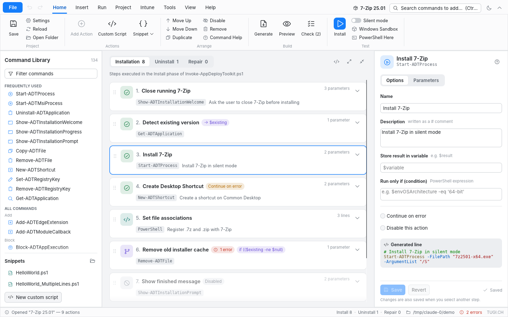
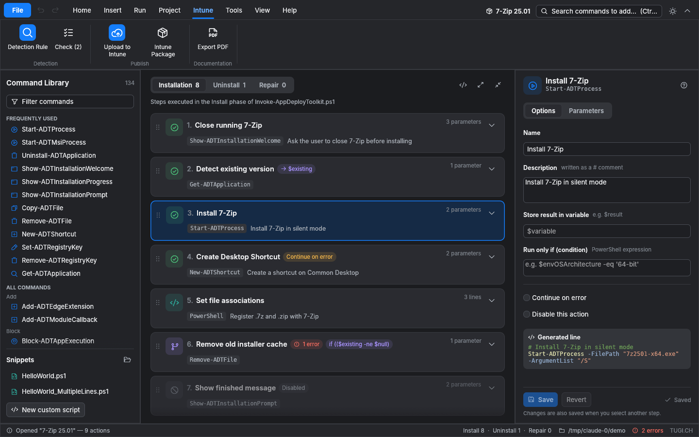
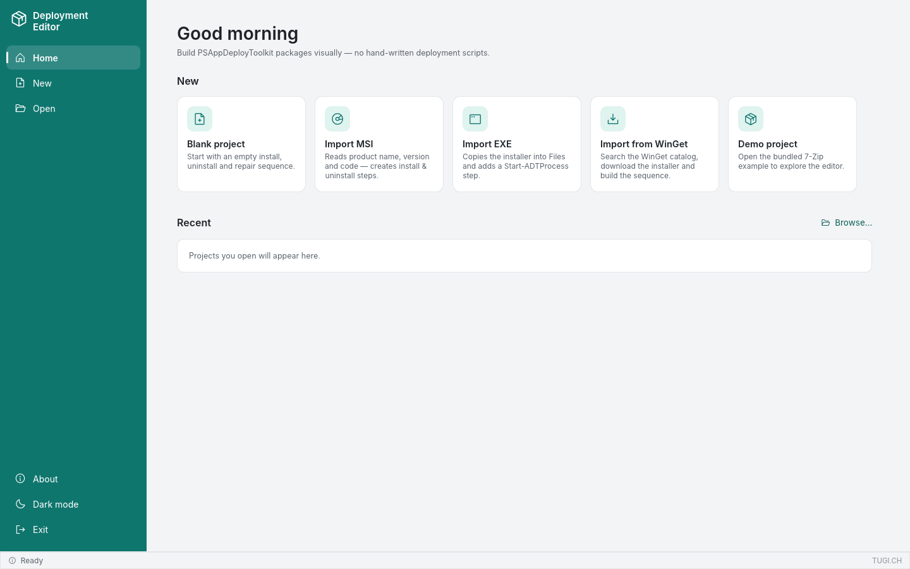
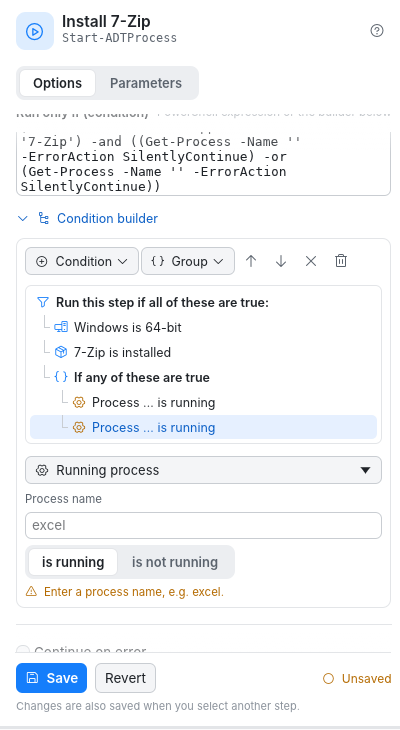
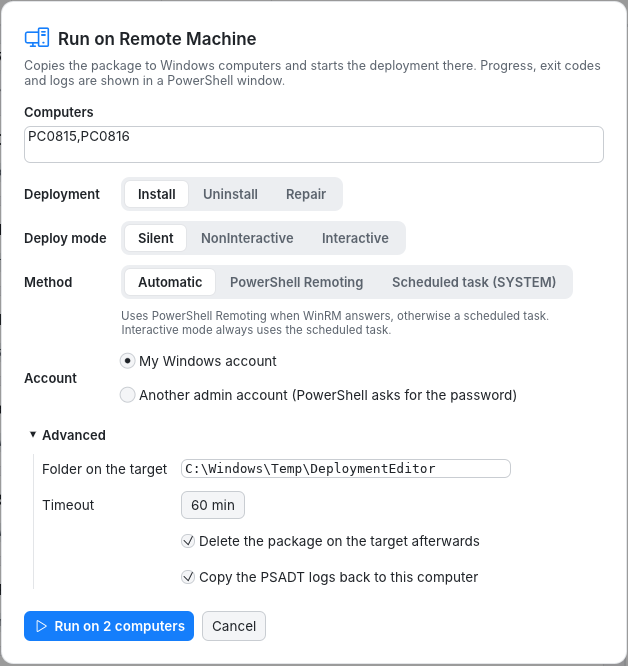
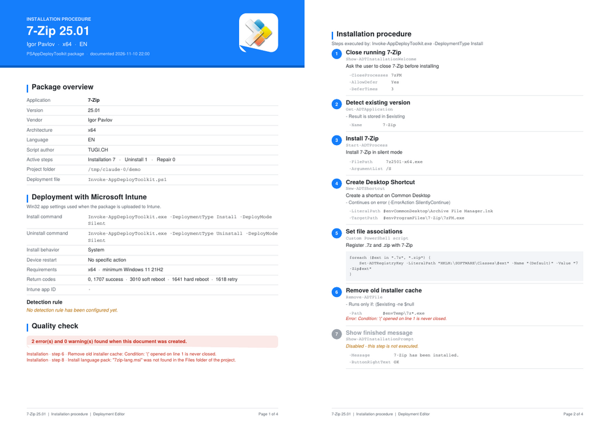

# DeploymentEditor 3 — Rust Edition
**Visual Software Packaging Editor for PSAppDeployToolkit (PSADT) v4**  
by **TUGI.CH**



---

## 🧑‍💻 About the Project

**DeploymentEditor** is a **visual, project-based software packaging editor** that makes it much easier to build
professional deployment packages with **PSAppDeployToolkit (PSADT) v4**.

This is the **Rust edition (v3)**: a complete rewrite of the original PureBasic DeploymentEditor (v2)
with an Office-style ribbon UI.
You build the install, uninstall and repair logic visually, and the editor **generates a fully structured,
production-ready `Invoke-AppDeployToolkit.ps1`** that follows PSADT best practices.

### Key Benefits
- 🚀 **Single portable `DeploymentEditor.exe`**: no .NET, no WebView2, no installation required  
- 🧩 **Visual sequence editor**: drag & drop steps, condition builder, live preview of the generated line  
- ☁️ **Native Intune upload**: builds the `.intunewin` and uploads the Win32 app through Microsoft Graph  
- 🖥 **Run on Remote Machine**: test a package on one or more computers via WinRM or as SYSTEM  
- ✅ **Quality check (F7)** and **undo / redo** for every change  
- 📄 **PDF documentation** of the installation procedure  
- 🌗 **Light and dark mode**  
- 🔁 **Drop-in compatible** with the PureBasic version: same project database, command catalog and templates  
- 🔓 **Free & Open Source**: no licensing costs, no limitations  

DeploymentEditor is ideal for:
- Endpoint Management Engineers (Intune, SCCM, MECM)
- Enterprise IT Administrators
- Software Packaging Specialists
- Anyone deploying Windows software at scale



---

## ✅ Getting Started

### System Requirements
- **Windows 10 / Windows 11**
- Native builds for **x64** and **ARM64** (Copilot+ PCs, VMware Fusion / Parallels on Apple Silicon)
- Any graphics adapter: DirectX 12, Vulkan or OpenGL 2.0+. VMs without 3D acceleration, Windows Sandbox
  and RDP sessions work with the software renderer (see [Graphics / Renderer](#-graphics--renderer))

### ⚠️ Important: PowerShell Execution Policy (Windows Settings)
DeploymentEditor generates and runs PowerShell scripts based on PSAppDeployToolkit (PSADT).
PowerShell script execution must therefore be enabled on the system where packages are built or tested.

### Prerequisites
There are **no external prerequisites** for running the editor.  
PSADT 4.1, the command catalog, templates, plugins and the demo project are included in this folder and in the
release packages.

---

## 📦 Installation

1. **Portable version**  
   - Download the latest x64 or ARM64 release from
     [GitHub Releases](https://github.com/tugich/DeploymentEditor/releases)  
   - Extract and run `DeploymentEditor.exe` (no installation required)

2. **From this repository**  
   - Clone or download the repository and run `DeploymentEditor.exe` from the repository root, next to its
     resource folders

### Execution Context
- The **editor itself runs in user context** and **does not require administrator privileges**
- **Administrator rights are only required** when you run a package (Install / Uninstall / Repair) in
  **system context**; the editor asks for elevation when needed

Optional command-line argument: a project `.db` or project folder to open.

---

## 🖥 User Interface



| Area | What it does |
|---|---|
| **File** (backstage) | Start screen: new blank project, import MSI / EXE / WinGet, demo project, recent projects, project info, about, dark mode |
| **Home** | Save, settings, add action / custom script / snippet, move / duplicate / enable-disable / remove, Generate, Preview, Install (F5), silent mode, Windows Sandbox |
| **Insert** | One-click common steps (Run EXE, Install MSI, Uninstall App, Shortcut, Registry, Copy/Remove file, Welcome, Progress, Prompt, Restart prompt) |
| **Run** | Install / Uninstall / Repair (elevated), Windows Sandbox, **Run on Remote Machine**, PowerShell here, log reader |
| **Project** | Settings, new from WinGet / MSI / EXE, open folders, open deployment file in VS Code / ISE / Notepad++, Export PDF, Intune package |
| **Intune** | Detection rule, Check, **Upload to Intune**, Intune package (.intunewin), Export PDF |
| **Tools** | Plugins, Software Log Reader (CMTrace + legacy format), Executables list, PSADT help console |
| **View** | Show/hide panes, dark mode, expand/collapse, deployment type |
| **Help** | PSADT docs & variables, command help (F1), GitHub, about |

The main window has three panes:
- **Command Library**: search, frequently used commands, drag a command into the sequence
- **Sequence**: step cards (drag to reorder) with badges for conditions, variables, continue-on-error and
  disabled steps, and expandable parameters
- **Properties**: Options with a live "generated line", Parameters with descriptions and type hints, and a
  syntax-highlighted script editor

Drop EXE / MSI / LNK / PS1 files onto the window to create steps, or a `.db` file to open a project.

### ⌨️ Keyboard Shortcuts

| Key | Action |
|---|---|
| Ctrl+S | Save the selected action |
| Ctrl+N / Ctrl+O | New / open project |
| Ctrl+K | Quick command search (Enter adds the first match) |
| F5 | Generate and run the installation |
| Ctrl+G / Ctrl+P | Generate deployment file / preview |
| Ctrl+D / Ctrl+E | Duplicate / enable-disable |
| Alt+↑ / Alt+↓ | Move step |
| ↑ / ↓, Delete | Select previous / next step, remove step |
| F1 | Online help for the selected command |
| F7 | Check the package for problems |
| Ctrl+Z / Ctrl+Y (Ctrl+Shift+Z) | Undo / redo (up to 100 steps, also in the title bar) |

---

## 🔀 Condition Builder

Under *Run only if (condition)* in the Options tab, the condition builder creates the condition visually, like the
Options tab of a ConfigMgr task sequence: **Condition ▾** adds a condition, **Group ▾** adds an
"all / any / none of these are true" group. Conditions can be nested, moved and removed.



| Condition | Generated PowerShell |
|---|---|
| Operating system | `$Is64Bit`, `$IsWorkstationOS`, `$IsServerOS`, `$IsMachinePartOfDomain`, `$IsMultiSessionOS`, `$IsTerminalServer` |
| Windows version | `[version]$envOSVersion -ge [version]'10.0.22631'` (picker for Windows 10/11/Server builds) |
| Installed application | `Get-ADTApplication -Name '7-Zip' [-NameMatch 'Exact']` |
| File or folder | `Test-Path -LiteralPath "$envProgramFiles\App\app.exe" -PathType Leaf` (path variables menu) |
| Registry key / value | `Test-Path -LiteralPath 'HKLM:\…'`, `(Get-ItemProperty …).'Version' -eq '1.0'` |
| Running process | `Get-Process -Name 'excel' -ErrorAction SilentlyContinue` |
| Variable | `$envOSArchitecture -eq 'X64'`, results of earlier steps (`$existing -ne $null`) … |
| Deploy mode | `$adtSession.DeployMode -eq 'Silent'` |
| PowerShell expression | anything else |

The builder and the text field stay in sync: existing conditions are read back into the tree, and
anything it does not recognise is kept unchanged as a *PowerShell expression*. Step cards, the PDF and the
quality check show the condition in plain language (e.g. "Windows is 64-bit and 7-Zip is not installed").

---

## ✅ Quality Check, Undo and Detection Rules

- **Check (F7)** runs before Generate, Run, Sandbox, Intune package and Upload. It finds missing key
  parameters, unbalanced brackets / quotes in scripts and conditions, invalid variable names, installer
  files missing from `Files\`, empty sequences and a missing detection rule. On Windows the PowerShell
  parser also checks every custom script. Errors block the action unless you choose
  *Continue anyway*; cards in the sequence show error / warning chips.
- **Undo / redo** covers every change to the project (steps, parameters, order, settings, detection rule).
- **Detection rule** (Intune tab) supports MSI product code, file / folder, registry and custom script
  rules, and proposes rules from the project: the MSI product code, a shortcut target, a registry step,
  or an Add/Remove Programs check. It is stored in the project database (`Intune_DetectionRule`).

---

## ☁️ Native Intune Upload

*Intune → Upload to Intune* replaces the `Upload_MicrosoftIntune` PowerShell plugin: no IntuneWin32App
module and no `IntuneWinAppUtil.exe` needed.

1. Generates the deployment file and builds the `.intunewin` natively (AES-256-CBC + HMAC-SHA256,
   same format as the Win32 Content Prep Tool).
2. Creates the Win32 app (or a new content version of an existing app, *Find in Intune*) through
   Microsoft Graph, uploads the content to Azure Storage in 6 MB blocks, commits it and sets the
   install / uninstall commands, requirements, return codes, detection rule and the `Assets\AppIcon.png` logo.

Sign in with either:

- **App registration**: tenant, client ID, client secret. The secret can be stored in the Windows
  Credential Manager (never in the project). Needs the *application* permission
  `DeviceManagementApps.ReadWrite.All` with admin consent.
- **Sign in with account**: device code sign-in with the Microsoft Graph Command Line Tools public client
  (or your own public client ID), delegated permission `DeviceManagementApps.ReadWrite.All`.

The app ID is saved in the project, so the next version can be uploaded as a new content version.
Editor files (`Invoke-AppDeployToolkit.db`, `*.ps1.template`, `Windows Sandbox.wsb`, `*.intunewin`) are
not included in the package.

---

## 🖧 Run on Remote Machine

*Run → Run on Remote* copies the package to one or more Windows computers and starts Install, Uninstall or
Repair there (Silent, NonInteractive or Interactive). A PowerShell window shows the progress per computer, the exit
code in plain words (e.g. *3010 – restart required*) and a summary. The new PSADT logs are copied back to
`%LOCALAPPDATA%\DeploymentEditor\RemoteLogs`.



| Method | How | Runs as | Needs on the target |
|---|---|---|---|
| PowerShell Remoting | `New-PSSession`, `Copy-Item -ToSession`, `Invoke-Command` | your admin account | WinRM (`Enable-PSRemoting`) |
| Scheduled task | copy via `\\computer\C$`, one-off task over CIM/DCOM | **SYSTEM** (like Intune) | File and Printer Sharing, Remote Scheduled Tasks Management / WMI in the firewall |
| Automatic | PowerShell Remoting if WinRM answers, otherwise scheduled task; Interactive always uses the task | | |

PSADT 4.1 shows its dialogs to the logged-on user when it runs as SYSTEM, so *Interactive* works with the
scheduled task. Choose *Another admin account* to be asked for credentials by PowerShell (`Get-Credential`): the
editor never handles the password. The editor files are not copied, and the package can be deleted from the
target afterwards. The generated scripts are kept in `%TEMP%\DeploymentEditor-Remote` for a day.

---

## 📄 PDF Documentation

*Project → Export PDF* (also on the Intune tab and in the File menu) writes an A4 document of the package: overview,
Intune settings and detection rule, quality check, every install / uninstall / repair step with its
parameters, conditions and scripts, and optionally the generated PowerShell as an appendix. The PDF is
written by a small built-in writer (no external tools) and has bookmarks for each section.
See the [sample documentation](docs/sample-documentation.pdf).



---

## 🎨 Graphics / Renderer

The editor draws with **wgpu** (DirectX 12 on Windows, Vulkan as alternative). Windows always provides a
software DirectX 12 (WARP), so the editor also starts in VMs without 3D acceleration, Windows Sandbox and RDP
sessions. If wgpu can't start, the editor restarts itself with **OpenGL** (2.0 or newer).
*File → About* shows the renderer and graphics adapter in use.

The editor prefers a real (or virtual VM) GPU through any API over software rendering, so a VM driver with
hardware OpenGL beats the software DirectX 12.

**Windows on Arm** (Copilot+ PCs, VMware Fusion / Parallels on Apple Silicon): use the native
`DeploymentEditor-windows-arm64` build. The x64 build runs there under emulation and can't load the ARM64
OpenGL driver of the VM, so it falls back to software rendering. In VMware Fusion, install VMware Tools and switch
on *Display → Accelerate 3D Graphics*. If rendering is still in software, switching off *Use full resolution for
Retina display* reduces the number of pixels to draw by a factor of four.

Force a renderer with `DeploymentEditor.exe --renderer dx` or `--renderer gl` (or the environment variable
`DE_RENDERER`). If neither works, a message box explains the options. Software OpenGL is available by copying
`opengl32.dll` (and the other DLLs) from the x64 folder of Mesa3D for Windows next to `DeploymentEditor.exe`.

---

## 📁 Folder Structure

The repository contains the source code and all runtime resources:

- **Databases/**  
  `PSADT.sqlite`: catalog of all PSADT commands, parameters and metadata

- **Templates/**  
  Templates for new projects, including `Invoke-AppDeployToolkit.ps1.template`

- **ThirdParty/**  
  PSAppDeployToolkit 4.1

- **Plugins/**  
  Editor plugins written in PowerShell (`Plugins\Enabled-*\Plugin.ini`)

- **Snippets/**  
  Reusable PowerShell snippets

- **Scripts/**  
  Helper scripts

- **Test/**  
  Demo project (7-Zip)

- **src/**  
  Rust source code (see [Source Layout](#source-layout))

- **docs/**, **assets/**  
  Screenshots, sample documentation and the application icon

- **tests/**  
  Mock of Entra ID / Microsoft Graph / Azure Blob storage for the Intune upload test

The executable looks for its resources (`Databases\PSADT.sqlite` etc.) next to itself, in the current
folder or its parent, or in `%DEPLOYMENT_EDITOR_HOME%`.

### 🧩 Project-Based Template System
Each deployment project contains its **own PSADT template**. When you generate the package,
`Invoke-AppDeployToolkit.ps1.template` is compiled into `Invoke-AppDeployToolkit.ps1`, so different customers,
environments or packaging standards can use different templates side by side.

---

## ⚙️ Compiling from Source

### Prerequisites
- **Rust** (via [rustup](https://rustup.rs), MSVC toolchain)
- **Visual Studio Build Tools** with the *Desktop development with C++* workload
  (`rusqlite` compiles SQLite from source)

### Build

```powershell
# from the repository root
cargo build --release
copy target\release\DeploymentEditor.exe .\DeploymentEditor.exe
```

`cargo run` starts the editor directly from the source.

### Tests

```powershell
$env:DE_REPO = (Resolve-Path .).Path
cargo test
```

`DE_REPO` enables the tests that need the resource folders, including a check that the generator produces
**byte-identical** output to the PureBasic version for the demo project. With `$env:DE_PWSH = 'powershell.exe'`,
`cargo test syntax -- --nocapture` also checks the generated PowerShell against Windows PowerShell 5.1.

The Intune upload can be tested end to end against a local mock of Entra ID / Graph / Azure Blob storage
(the endpoint overrides only work in debug builds):

```bash
python3 tests/mock_graph.py 18765 ./mock-state &
DE_LOGIN_BASE=http://127.0.0.1:18765 DE_GRAPH_BASE=http://127.0.0.1:18765/beta \
  cargo test upload_against_mock_graph -- --ignored
```

### Source Layout

| File | Purpose |
|---|---|
| `src/catalog.rs` | PSADT command / parameter catalog (`PSADT.sqlite`) |
| `src/project.rs` | Project database: actions, values, settings, step ordering, schema migration |
| `src/generator.rs` | Script generation (port of `BuildScript` / `GenerateDeploymentFile`) |
| `src/system.rs` | Elevated launches (encoded PowerShell `Start-Process -Verb RunAs`), Sandbox, MSI reading, PowerShell syntax check |
| `src/validate.rs` | Pre-generate quality check |
| `src/detection.rs` | Intune detection rules and suggestions |
| `src/remote.rs` | Run on Remote Machine (package, target and controller scripts) |
| `src/condition.rs`, `src/ui/condition_builder.rs` | Condition model (to / from PowerShell) and the visual builder |
| `src/intunewin.rs` | Native `.intunewin` packager |
| `src/intune.rs` | Microsoft Graph client: sign-in, Win32 app create / update, content upload |
| `src/pdf.rs`, `src/pdf_metrics.rs`, `src/report.rs` | PDF writer and the installation documentation |
| `src/winget.rs` | WinGet search (`winget search`), manifest parsing, installer download |
| `src/logs.rs` | CMTrace / legacy PSADT log parser |
| `src/plugins.rs` | `Plugins\Enabled-*\Plugin.ini` and snippets |
| `src/ui/*` | Ribbon, backstage, library, sequence, inspector, dialogs |
| `src/theme.rs`, `src/widgets.rs` | Fluent-style palette (light/dark), fonts (Segoe UI), custom ribbon widgets |

---

## 🔄 Differences to the PureBasic Version

- **Drop-in compatible**: same project database (`Invoke-AppDeployToolkit.db`), same `Databases/PSADT.sqlite`
  command catalog, same `Templates`, `ThirdParty`, `Plugins`, `Snippets` and `Scripts` folders. Projects
  can be opened in both versions.
- The script generator is a faithful port of `BuildScript()`: a unit test checks that the demo project
  produces **byte-identical** output.
- **WinGet import** no longer downloads the whole winget-pkgs repository; it uses `winget search` and
  fetches only the selected installer manifest. Without the winget CLI you can type identifier + version.
- The Monaco editor and the HTML log reader are replaced by native components, so the `Web` folder is
  no longer needed.
- New: native Intune upload and packaging, detection rule editor, condition builder, quality check, undo / redo,
  PDF documentation.
- New: drag & drop reordering, duplicate action, quick-insert gallery, generated-line preview, dark mode,
  MSI uninstall step by ProductCode, MSI / PS1 file drops.
- New: **Run on Remote Machine** (not implemented in the original): PowerShell Remoting or a SYSTEM
  scheduled task, several computers at once, logs copied back.

---

## 📋 Usage

### Video Tutorial
📺 **YouTube walkthrough** (recorded with the PureBasic version; the workflow is the same):  
[Deployment Editor – Package Software with PSAppDeployToolkit (PSADT)](https://www.youtube.com/watch?v=1Ct5B27BGP4)

The tutorial demonstrates:
- Creating a new project  
- Building install & uninstall sequences  
- Packaging 7-Zip as a real-world example  

If you have questions, feedback, or feature requests, feel free to reach out.

---

## 📄 License

This project is licensed under the **GNU General Public License v3.0 or later**, see `LICENSE`.

---

## 📄 Credits & Third-Party Software

- PSAppDeployToolkit (`LICENSE_PSADT`)  
  https://github.com/PSAppDeployToolkit/PSAppDeployToolkit

Additional third-party licenses (SQLite, 7-Zip demo installer, Rust crates) can be found in `LICENSE_ThirdParty`.

---

## 📧 Contact

**TUGI**  
📩 Email: [contact@tugi.ch](mailto:contact@tugi.ch)  
🌐 Project Page: https://blog.tugi.ch/deployment-editor-preview
